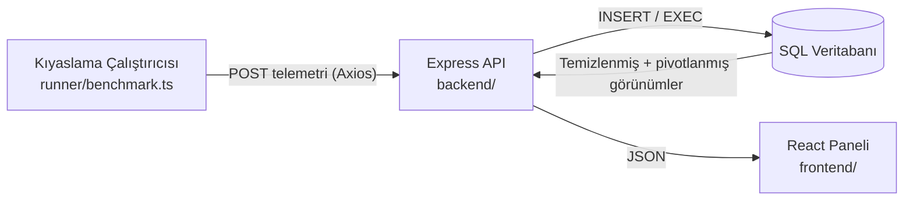
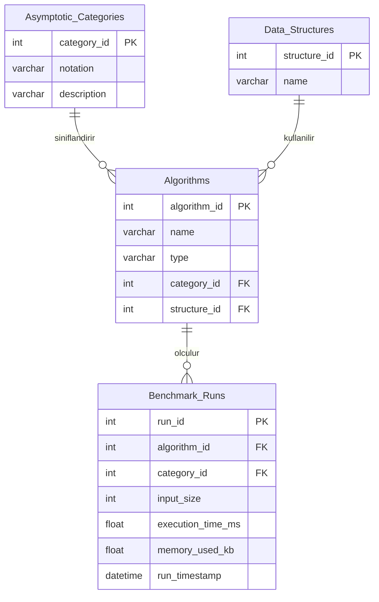

# Algoritma Kıyaslama ve Analiz Paneli

Arama ve sıralama algoritmalarının **deneysel zaman ve alan karmaşıklığını**, farklı veri kümesi boyutları üzerinde karşılaştırmak amacıyla kod çalıştırma verilerini toplayan tam yığın (full-stack) bir kıyaslama platformu ve veritabanı sistemi.

Teorik Big-O gösterimi algoritmaların asimptotik olarak nasıl ölçeklendiğini açıklar; ancak gerçek dünyadaki çalışma performansı donanıma, bellek ayırmaya ve altta yatan veri yapılarına bağlıdır. Bu platform, birden fazla girdi boyutu (`N`) için çalışma telemetrisini (çalışma süresi ve bellek kullanımı) yakalar, ham veriyi veritabanı katmanında doğrular ve temizler, ardından yan yana performans eğrilerini bir analiz panelinde görselleştirir.

---

## Takım Üyeleri

- Doğukan Araz 230260174
- İlhami Bozkurt 220260158
- Abdullah Şeyh Hilal 210260602

## İçindekiler

- [Özellikler](#özellikler)
- [Teknoloji Yığını](#teknoloji-yığını)
- [Mimari](#mimari)
- [Depo Yapısı](#depo-yapısı)
- [Veritabanı Tasarımı](#veritabanı-tasarımı)
- [Başlarken](#başlarken)
- [Yapılandırma](#yapılandırma)
- [API Referansı](#api-referansı)
- [Nasıl Çalışır](#nasıl-çalışır)
- [Yol Haritası](#yol-haritası)
- [Katkıda Bulunma](#katkıda-bulunma)
- [Lisans](#lisans)

---

## Özellikler

- **Çalışma telemetrisi yakalama**: Çalıştırıcı (runner), algoritmaları üretilen veri kümeleri üzerinde yürütür ve her çalıştırma için süre ile bellek kullanımını kaydeder.
- **Veritabanı katmanında aykırı değer temizleme**: SQL pencere fonksiyonları ve standart sapma (`STDEV` / `STDDEV`), işletim sistemi kaynaklı gecikme sıçramalarını eleyerek her algoritma ve girdi boyutu için güvenilir bir ortalama çalışma süresi üretir.
- **Dinamik veri pivotlama**: Satır bazlı kıyaslama kayıtları, girdi boyutuna göre gruplanmış yan yana sütunlara (ör. BFS - DFS - Uniform Cost Search) dönüştürülür ve doğrudan grafik çizimine hazır hale gelir.
- **Katı referans bütünlüğü**: Kısıtlar ve tetikleyiciler (trigger), bir algoritmanın yalnızca geçerli teorik Big-O kategorisi altında kaydedilebilmesini sağlar (ör. `O(N^2)` bir algoritmanın `O(N log N)` kategorisi altında kaydedilmesi engellenir).
- **Analiz paneli**: Deneysel performans eğrilerini teorik beklentilerle karşılaştıran etkileşimli React grafikleri.

## Teknoloji Yığını

| Katman                             | Teknoloji                           |
| ---------------------------------- | ----------------------------------- |
| Veritabanı                         | PostgreSQL                          |
| Kıyaslama çalıştırıcısı ve backend | Node.js, TypeScript, Express, Axios |
| Frontend paneli                    | React, Vite, Chart.js               |

## Mimari



1. **Çalıştırıcı**, her algoritmayı birden fazla `N` değeri için yürütür ve sonuçları API'ye gönderir.
2. **Backend**, gelen verileri doğrular ve `Benchmark_Runs` tablosuna yazar; bütünlük kurallarını veritabanı uygular.
3. **Görünümler ve saklı yordamlar** (stored procedures) veriyi temizler (aykırı değer eleme) ve pivotlar.
4. **Panel**, işlenmiş veriyi çeker ve karşılaştırma grafiklerini çizer.

## Depo Yapısı

```plaintext
├── database/
│   ├── schema.sql          # Tablolar, kısıtlar ve indeksler için DDL betikleri
│   ├── seed.sql            # Başlangıç Big-O kategorileri, veri yapıları ve algoritmalar
│   └── procedures.sql      # Aykırı değer temizleme ve pivotlama için görünümler ve saklı yordamlar
├── runner/
│   └── benchmark.ts        # Algoritmaları çalıştırıp telemetriyi gönderen betik
├── backend/
│   └── src/                # Veritabanını panele bağlayan Express API
├── frontend/
│   └── src/                # Vite + React analiz paneli
└── README.md
```

## Veritabanı Tasarımı

### Temel Varlıklar

| Tablo                   | Amaç                                                                                                                                                                           |
| ----------------------- | ------------------------------------------------------------------------------------------------------------------------------------------------------------------------------ |
| `Asymptotic_Categories` | Teorik Big-O sınıflarını tutan arama (lookup) tablosu: `O(1)`, `O(log N)`, `O(N)`, `O(N log N)`, `O(N^2)` vb.                                                                  |
| `Data_Structures`       | Çalıştırma sırasında kullanılan veri yapılarını tanımlayan arama tablosu: Array, Adjacency List, Priority Queue vb.                                                            |
| `Algorithms`            | Test edilen arama ve sıralama algoritmalarının kataloğu: Merge Sort, A\* Search, BFS, DFS, Uniform Cost Search vb. Her algoritma bir kategoriye ve bir veri yapısına bağlıdır. |
| `Benchmark_Runs`        | Tekil çalıştırmaların telemetri kaydı: algoritma, girdi boyutu, çalışma süresi ve kullanılan bellek.                                                                           |

### Varlık-İlişki Diyagramı

> Aşağıdaki sütun adları örnek amaçlıdır; kesin tanımlar için `database/schema.sql` dosyasına bakabilirsiniz.



### Temel Veritabanı Özellikleri

#### 1. Matematiksel Toplulaştırmalar (Aykırı Değer Temizleme)

Ham süre ölçümleri gürültülüdür: çöp toplama (garbage collection), işletim sistemi zamanlaması ve arka plan süreçleri gecikme sıçramalarına yol açar. Her `(algoritma, girdi_boyutu)` grubu için pencere fonksiyonları ortalamayı ve standart sapmayı hesaplar; belirlenen eşiğin (ör. ortalamadan 2 standart sapmadan fazla uzaklık) dışında kalan çalıştırmalar, gerçek ortalama hesaplanmadan önce elenir.

#### 2. Dinamik Veri Pivotlama

Satır bazlı kayıtları, her girdi boyutu için tek satır ve her algoritma için bir sütun olacak şekilde dönüştürür; grafik kütüphanelerinin beklediği biçim budur.

| input_size |  BFS |  DFS | Uniform Cost Search |
| ---------: | ---: | ---: | ------------------: |
|      1.000 | 0,42 | 0,39 |                0,88 |
|     10.000 | 4,10 | 3,87 |               11,52 |
|    100.000 | 41,7 | 39,9 |               142,3 |

_(Değerler yalnızca örnek amaçlıdır.)_ T-SQL'de `PIVOT` ile, PostgreSQL'de koşullu toplulaştırma / `crosstab` ile uygulanır.

#### 3. Katı Referans Bütünlüğü

- Yabancı anahtarlar (foreign key) algoritmaları kategorilerine ve veri yapılarına, çalıştırmaları ise algoritmalarına bağlar.
- Bir tetikleyici (ve/veya bileşik yabancı anahtar), kaydedilen çalıştırmadaki kategorinin algoritmanın geçerli teorik kategorisiyle eşleştiğini doğrular. Böylece `O(N^2)` bir algoritmanın `O(N log N)` altında kaydedilmesi gibi uyumsuzluklar ekleme anında reddedilir.
- `(algorithm_id, input_size)` üzerindeki indeksler toplulaştırma sorgularını hızlı tutar.

## Başlarken

### Gereksinimler

- Node.js 18+ ve npm
- SQL Server **veya** PostgreSQL ve nesne oluşturma yetkiniz olan bir veritabanı

### 1. Veritabanını Başlatın

`/database` klasöründeki betikleri **sırayla** çalıştırın:

```plaintext
schema.sql  →  seed.sql  →  procedures.sql
```

Örnek (PostgreSQL):

```bash
psql -d benchmarks -f database/schema.sql
psql -d benchmarks -f database/seed.sql
psql -d benchmarks -f database/procedures.sql
```

Örnek (SQL Server):

```bash
sqlcmd -S localhost -d Benchmarks -i database/schema.sql
sqlcmd -S localhost -d Benchmarks -i database/seed.sql
sqlcmd -S localhost -d Benchmarks -i database/procedures.sql
```

### 2. Backend API'yi Başlatın

```bash
cd backend
npm install
npm run dev
```

### 3. Kıyaslama Betiğini Çalıştırın

```bash
cd runner
npm install
npm start
```

### 4. Paneli Başlatın

```bash
cd frontend
npm install
npm run dev
```

Ardından Vite'ın yazdırdığı adresi açın (genellikle `http://localhost:5173`).

## Yapılandırma

Her paket ayarlarını bir `.env` dosyasından okur. Aşağıdaki değişken adları öneridir; kodunuza göre uyarlayın.

**`backend/.env`**

```env
PORT=3000
DB_CLIENT=postgres        # veya: mssql
DB_HOST=localhost
DB_PORT=5432
DB_NAME=benchmarks
DB_USER=kullanici_adiniz
DB_PASSWORD=sifreniz
```

**`runner/.env`**

```env
API_URL=http://localhost:3000
INPUT_SIZES=100,1000,10000,100000
RUNS_PER_SIZE=30
```

**`frontend/.env`**

```env
VITE_API_URL=http://localhost:3000
```

> `.env` dosyalarını asla depoya eklemeyin. `.gitignore` dosyanıza ekleyin.

## API Referansı

> Örnek uç noktalardır; `backend/src/` içindeki gerçek uygulamanıza göre güncelleyin.

| Yöntem | Uç Nokta                                    | Açıklama                                                                                            |
| ------ | ------------------------------------------- | --------------------------------------------------------------------------------------------------- |
| `POST` | `/api/runs`                                 | Bir kıyaslama çalıştırması gönderir (`algorithmId`, `inputSize`, `executionTimeMs`, `memoryUsedKb`) |
| `GET`  | `/api/algorithms`                           | Algoritmaları Big-O kategorisi ve veri yapısıyla listeler                                           |
| `GET`  | `/api/results/clean`                        | Algoritma ve girdi boyutu başına aykırı değerlerden arındırılmış ortalama süre                      |
| `GET`  | `/api/results/pivot?algorithms=BFS,DFS,UCS` | Girdi boyutuna göre gruplanmış, yan yana pivotlanmış karşılaştırma                                  |

Örnek gönderim:

```bash
curl -X POST http://localhost:3000/api/runs \
  -H "Content-Type: application/json" \
  -d '{"algorithmId": 3, "inputSize": 10000, "executionTimeMs": 4.12, "memoryUsedKb": 812}'
```

## Nasıl Çalışır

1. **Tohumlama (Seed)**: Big-O kategorileri, veri yapıları ve algoritma kataloğu yüklenir.
2. **Çalıştırma**: `benchmark.ts`, her `N` için veri kümeleri üretir, her algoritmayı tekrar tekrar çalıştırır ve gerçek geçen süreyi ile belleği ölçer.
3. **Gönderme**: Sonuçlar Axios ile Express API'ye POST edilir ve `Benchmark_Runs` tablosuna eklenir. Geçersiz kategori/algoritma kombinasyonları veritabanı tarafından reddedilir.
4. **Temizleme**: Görünümler ve saklı yordamlar istatistiksel aykırı değerleri ayıklar ve gerçek ortalamaları hesaplar.
5. **Pivotlama**: Temizlenmiş ortalamalar, her `N` için bir satır ve her algoritma için bir sütun olacak şekilde yeniden düzenlenir.
6. **Görselleştirme**: Panel, süre ve bellek eğrilerini çizer; böylece deneysel büyüme teorik Big-O sınıfıyla karşılaştırılabilir.

## Yol Haritası

- [ ] Daha fazla algoritma ekleme (Dijkstra, Quick Sort, Heap Sort, Binary Search)
- [ ] Sorgu başına yapılandırılabilir aykırı değer eşiği (z-skoru sınırı)
- [ ] Büyüme oranlarını okumayı kolaylaştırmak için log-log grafik modu
- [ ] Sonuçları CSV olarak dışa aktarma
- [ ] Veritabanı, backend ve frontend için Docker Compose kurulumu

## Katkıda Bulunma

Katkılarınızı bekliyoruz.

1. Depoyu fork'layın
2. Bir özellik dalı oluşturun: `git checkout -b feature/my-feature`
3. Değişikliklerinizi commit'leyin: `git commit -m "Add my feature"`
4. Dalı gönderin: `git push origin feature/my-feature`
5. Bir pull request açın

## Lisans

MIT Lisansı altında dağıtılmaktadır. Ayrıntılar için `LICENSE` dosyasına bakın. _(Tercih ettiğiniz lisansla değiştirin.)_
